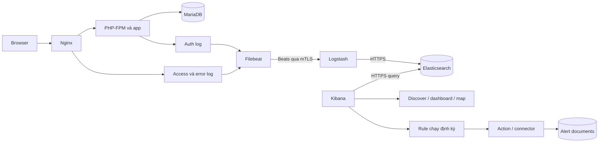
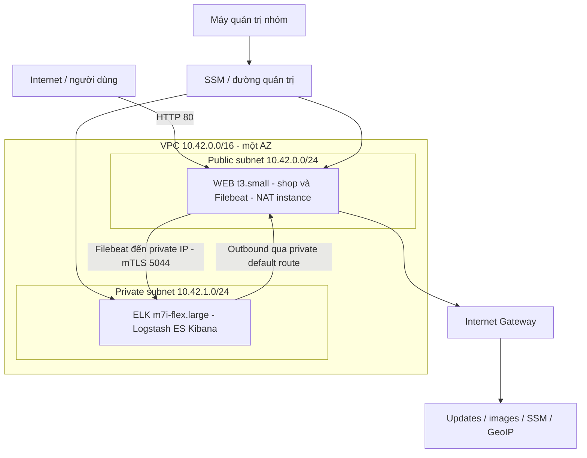

# Sổ tay học hiểu PBL4 dành cho Hoàng — lead nhóm

> Bản tài liệu public trên nhánh `baocaolan1` của PBL4-docs. Link đọc code/bằng chứng chi tiết trỏ đến repo **PBL4-demo private**, cần quyền truy cập; clone repo tài liệu không có app/scripts để chạy các lệnh. Bộ tài liệu này không công bố credentials, log thô hay runtime riêng. Các ví dụ và số liệu lab không phải cam kết production.

Ngày viết: **13/10/2026**. Source tham chiếu: nhánh `bao-cao-tien-do-lan-1`, commit nền `1de1885`; kết quả AWS là phiên **12/10/2026**. Tài liệu này giải thích hệ thống và cách suy luận, không xác nhận một lần chạy AWS mới. Khi source thay đổi, đối chiếu lại các link và thông số.

## Mục lục và cách học

1. [Lead cần hiểu đến mức nào](#1-lead-cần-hiểu-đến-mức-nào)
2. [Bài toán và bức tranh tổng thể](#2-bài-toán-và-bức-tranh-tổng-thể)
3. [Nền tảng trước khi đọc code](#3-nền-tảng-trước-khi-đọc-code)
4. [Lần theo request website](#4-lần-theo-request-website)
5. [Hiểu log và dữ liệu](#5-hiểu-log-và-dữ-liệu)
6. [Filebeat và vận chuyển](#6-filebeat-và-vận-chuyển)
7. [Logstash và chuẩn hóa](#7-logstash-và-chuẩn-hóa)
8. [Elasticsearch, mapping, ingest và ILM](#8-elasticsearch-mapping-ingest-và-ilm)
9. [Kibana, dashboard và GeoIP](#9-kibana-dashboard-và-geoip)
10. [Bốn luật phát hiện và vòng đời](#10-bốn-luật-phát-hiện-và-vòng-đời)
11. [Kiến trúc AWS và đường mạng](#11-kiến-trúc-aws-và-đường-mạng)
12. [Bảo mật và những giới hạn](#12-bảo-mật-và-những-giới-hạn)
13. [Kiểm thử, bằng chứng và số liệu](#13-kiểm-thử-bằng-chứng-và-số-liệu)
14. [Chẩn đoán lỗi theo từng chặng](#14-chẩn-đoán-lỗi-theo-từng-chặng)
15. [Chi phí và vận hành](#15-chi-phí-và-vận-hành)
16. [Dẫn nhóm và chuẩn bị báo cáo](#16-dẫn-nhóm-và-chuẩn-bị-báo-cáo)
17. [Lộ trình học và bài tập](#17-lộ-trình-học-và-bài-tập)
18. [Từ điển và câu hỏi bảo vệ](#18-từ-điển-và-câu-hỏi-bảo-vệ)

Đừng đọc một lượt để thuộc tên công nghệ. Mỗi phần học theo vòng: **đọc giải thích → mở source → tự vẽ/lần theo một ví dụ → trả lời câu hỏi → kiểm tra bằng dữ liệu**. Chưa trả lời được thì quay lại đúng chặng đang thiếu. Có thể đọc 60–90 phút mỗi buổi, chia theo chương 17.

Các đoạn JSON minh họa dưới đây là **dữ liệu giả để học**, không phải evidence AWS. Các lệnh là hướng dẫn trong tài liệu, chưa được thực thi chỉ vì bạn đọc file. Chỉ vận hành môi trường nhóm kiểm soát; thông tin tài khoản lấy riêng, không chép vào Git hoặc slide.

## 1. Lead cần hiểu đến mức nào

Bạn cần nắm cả kiến trúc, dữ liệu, kiểm chứng và điều phối. Không cần nhớ mọi dòng code, nhưng cần biết câu hỏi nào do ai trả lời và bằng chứng nào đủ để kết luận.

Một lead hiểu hệ thống phải làm được sáu việc:

1. Giải thích đường đi của một request từ browser đến website, log, Elasticsearch, dashboard và alert.
2. Chỉ ra nơi tạo từng trường quan trọng: IP, timestamp, request ID, dataset, country, count, threshold.
3. Phân biệt source đã viết, cấu hình đã cài, backend đã chạy, giao diện đã kiểm và buổi demo đã tập.
4. Khi lỗi xảy ra, khoanh vùng bằng quan sát thay vì restart toàn bộ một cách tùy ý.
5. Đọc kết quả kiểm thử cùng môi trường/phiên/version và giới hạn, không lấy một số PASS để nhận toàn bộ hoàn thành.
6. Chia công việc thành đầu ra có thể nhận, có owner, tiêu chí đạt và người kiểm tra chéo.

Ví dụ: Bảo nói “dashboard xong”. Bạn cần làm rõ dashboard đã viết definition, import thành công, query có dữ liệu, render đúng trên browser hay đã dùng trong rehearsal. Mỗi mức là một kết quả khác nhau. Hỏi chính xác giúp nhóm biết việc tiếp theo, không phải nghi ngờ người làm.

## 2. Bài toán và bức tranh tổng thể

### 2.1 Hai phần của đồ án

**Phần ứng dụng:** shop PHP có sản phẩm, tìm kiếm, login/logout và giỏ hàng. MariaDB chứa dữ liệu shop. Đây là nơi người dùng thao tác và tạo sự kiện.

**Phần quan sát/phát hiện:** thu gom log, làm sạch và chuẩn hóa, lưu/tìm kiếm, trực quan hóa, kiểm rule để nhận diện mẫu bất thường. Elasticsearch chứa log/alert, không thay MariaDB làm database nghiệp vụ của shop.

Shop chạy được mà pipeline hỏng: người dùng vẫn xem sản phẩm, nhóm mất khả năng quan sát. Pipeline chạy được mà shop hỏng: có thể thấy lỗi nhưng người dùng không dùng shop được. Hai phần liên quan nhưng phải nghiệm thu riêng và nghiệm thu luồng nối giữa chúng.

### 2.2 Sơ đồ logic



Mũi tên browser→website là đường phục vụ ứng dụng. Mũi tên log→pipeline là đường dữ liệu quan sát. Kibana query Elasticsearch để đọc dữ liệu; không phải mọi log phải “chạy xuyên qua Kibana” rồi mới được lưu. Action là bước tiếp theo khi rule có kết quả, không phải Logstash tự đọc mọi rule rồi phát email.

### 2.3 Trả lời “nhóm làm gì?” trong 30 giây

> Nhóm xây dựng một website shop làm nguồn dữ liệu, thu thập ba loại log vào pipeline Filebeat–Logstash–Elasticsearch, hiển thị trên Kibana và kiểm bốn mẫu bất thường theo IP hoặc toàn website. Demo đã triển khai trên AWS với WEB public và ELK private, có bằng chứng backend và kiểm thử vòng đời cảnh báo. Phần giao diện AWS, một số cổng nghiệm thu và đánh giá final còn tiếp tục.

Không cần khởi đầu bằng một danh sách dài tên công nghệ. Bắt đầu từ vấn đề, luồng giải quyết, kết quả đã có rồi mới đi vào thành phần.

## 3. Nền tảng trước khi đọc code

### 3.1 Máy, tiến trình, container và dịch vụ

EC2 là máy ảo AWS chạy Ubuntu. Docker là môi trường chạy container trên máy đó. Image là bộ filesystem/phần mềm dùng tạo container; container là một instance chạy từ image. Service trong Compose là định nghĩa cách chạy container: image/build, environment, networks, volumes, ports, dependencies và health check.

Hai EC2 không có nghĩa chỉ hai container. AWS hiện tách WEB gồm Nginx/PHP/MariaDB/Filebeat và ELK gồm Logstash/Elasticsearch/Kibana: tổng **7 dịch vụ dài hạn**. `certificates` và `accounts` là công việc bootstrap chạy xong rồi thoát; exit 0 của chúng có thể là trạng thái đúng, không phải dịch vụ cần luôn healthy.

### 3.2 Port và địa chỉ bind

Port giúp phân biệt dịch vụ trên cùng địa chỉ IP. `80` cho shop HTTP, `9000` cho PHP-FPM trong mạng ứng dụng, `3306` cho MariaDB, `5044` cho Beats, `9200` cho Elasticsearch HTTP API, `5601` cho Kibana.

`network.host: 0.0.0.0` bên trong container nghĩa là lắng nghe các interface **của container**, không tự động có nghĩa mở ra toàn Internet. Cần xem thêm publish ports của Docker, interface host, route AWS và Security Group. Kibana config lắng nghe trong container nhưng Compose publish `127.0.0.1:5601:5601`, chỉ loopback của host; đó là hai lớp khác nhau.

`127.0.0.1` luôn là “máy/môi trường mạng hiện tại”. Trong container PHP, localhost không phải container MariaDB. Trong browser laptop, localhost không phải EC2 ELK. Vì vậy source dùng DNS service name như `mariadb`, `php`, `elasticsearch`; muốn laptop tới dịch vụ loopback EC2 cần đường forwarding đã kiểm.

### 3.3 File, volume và bind mount

Container có thể bị tạo lại. Dữ liệu chỉ nằm trong filesystem tạm của container có thể mất khi bỏ container. Volume dành cho dữ liệu bền như DB, log, Elasticsearch data và Filebeat registry. Bind mount đưa thư mục/file của host vào container, ví dụ source app và cấu hình.

`ro` là mount chỉ đọc. PHP đọc source nhưng cần ghi auth log ở volume riêng; Filebeat đọc log nhưng không nên sửa log nguồn. Mount sai có thể khiến source host có mà container thấy thư mục rỗng; lỗi PHP bind mount của phiên local là ví dụ đã ghi trong [tiến độ ngày 2](https://github.com/hoangFan1005/PBL4-demo/blob/1de188527799033647415e269093e1d266bbe839/docs/day-2-progress.md).

`restart: unless-stopped` giúp dịch vụ khởi động lại trong điều kiện Docker phù hợp, không chứng minh app sẽ healthy sau mọi lỗi. `depends_on: service_healthy` kiểm dependency lúc khởi động, không thay giám sát mọi lỗi xảy ra về sau.

### 3.4 Ba loại “thời điểm”

Thời gian sự kiện là lúc request/auth xảy ra. Thời gian ingest là lúc Elasticsearch nhận document qua ingest pipeline. Thời gian quan sát là lúc người xem thấy nó trên giao diện. Chúng khác nhau vì có shipping, xử lý, indexing/search visibility và browser refresh.

Code chuẩn hóa về UTC; tài liệu/phiên báo cáo có thể dùng giờ Việt Nam UTC+7. `2026-10-12T14:37:58+00:00` tương ứng `21:37:58` cùng ngày ở Việt Nam. Đừng đổi timezone bằng cách cộng 7 giờ vào giá trị rồi vẫn ghi `Z`; điều đó làm timestamp sai.

## 4. Lần theo request website

Source chính: [Nginx](https://github.com/hoangFan1005/PBL4-demo/blob/1de188527799033647415e269093e1d266bbe839/infra/nginx/nginx.conf), [bootstrap PHP](https://github.com/hoangFan1005/PBL4-demo/blob/1de188527799033647415e269093e1d266bbe839/app/src/bootstrap.php), [Shop](https://github.com/hoangFan1005/PBL4-demo/blob/1de188527799033647415e269093e1d266bbe839/app/src/Shop.php), [login](https://github.com/hoangFan1005/PBL4-demo/blob/1de188527799033647415e269093e1d266bbe839/app/public/login.php).

### 4.1 Request xem sản phẩm

Giả sử browser gửi `GET /product.php?id=1` tới WEB. Nginx nhận kết nối, xác định file PHP tồn tại bằng `try_files`, ghép `SCRIPT_FILENAME` từ document root `/var/www/html/public`, rồi chuyển xử lý sang `php:9000` bằng FastCGI.

PHP nạp bootstrap, bắt đầu session, đặt header, kết nối MariaDB qua PDO. `Shop::product()` dùng prepared query theo ID. App tạo HTML, trả cho Nginx và browser. Nginx ghi một access event cho request này với IP, URI, status, bytes, duration và request ID.

Browser có thể tiếp tục tải CSS hoặc request khác. Vì vậy “bấm một lần” không tương đương “đúng một access event”. Muốn kiểm số đếm, dùng request cụ thể và time range cụ thể, không chỉ số thao tác tay.

### 4.2 Request ID được tạo ở đâu?

Nginx dùng `$request_id`, trả header `X-Request-ID` và truyền FastCGI `REQUEST_ID` vào PHP. `Shop::requestId()` đọc server variable này. Trong test PHP built-in server không có Nginx, helper có thể tự tạo ID ngẫu nhiên.

Client gửi header `X-Request-ID` tùy ý không được coi là server variable `REQUEST_ID` đáng tin. Phân biệt **header từ khách** và **giá trị do Nginx gán**. Request ID giúp nối access/auth cho cùng request, không thay chữ ký hoặc bằng chứng chống chỉnh sửa log.

### 4.3 Một lần đăng nhập sai, từng bước

1. GET `/login.php` tải form. Bootstrap tạo session; `csrf()` đưa token vào hidden input. GET này tạo access log, chưa tạo login_failed.
2. Browser giữ session cookie và POST email/password/token đến `/login.php`.
3. `requirePost()` kiểm method và CSRF. Nếu token sai, trả 403 trước authenticate; đây không phải một login_failed đã xác thực theo flow hiện tại.
4. `Shop::authenticate()` query user bằng email, dùng `password_verify` so với hash. Với user không tồn tại, vẫn chạy verify với hash dự phòng để tránh đường xử lý quá rẻ khác biệt; không gọi đây là bảo đảm hoàn toàn không có timing side channel.
5. `logAuth(false, ...)` ghi JSON với `event.action=login_failed`, IP, request ID, user name và thời gian. Không ghi password vào auth event.
6. App trả 401 với thông báo chung. Nginx ghi access event status 401 cho POST đó.

Kết quả: một POST thất bại tạo **một auth outcome và một access event**, còn GET form tạo access riêng. R2 đếm auth failed, R1/R4 đếm access; không cộng hai index để gọi là số request.

### 4.4 Khi đăng nhập thành công

Sau authenticate và ghi auth success, app thay session ID bằng `session_regenerate_id(true)`, lưu user vào session, đổi CSRF token và trả redirect 302 về index. Nếu browser theo redirect sẽ có GET tiếp theo. Không phải mọi login success trả HTTP 200 trên POST; status và nghiệp vụ phải đọc theo đúng flow.

Nếu auth log không ghi được, `logAuth` ném exception; handler chung trả 503. Đăng nhập thành công về xác thực chưa chắc thành công toàn bộ request. Đây là lý do kiểm chức năng và log cùng nhau.

### 4.5 Các cơ chế web không nên nhầm

| Cơ chế | Mục đích trong code | Không chứng minh điều gì? |
|---|---|---|
| Prepared statements | Truyền dữ liệu tách khỏi cú pháp SQL | Không phải bảo vệ mọi loại lỗi web |
| Password hash/verify | Không lưu password dạng plaintext trong bảng user | Không mã hóa traffic HTTP ngoài Internet |
| Session | Ghi nhớ trạng thái người dùng giữa các request | Không phải log history hoặc DB giỏ hàng bền qua mọi session |
| CSRF token | Kiểm form thuộc session trước xử lý POST | Không phải ngăn brute force của client lấy token hợp lệ |
| HTML escaping | Escape nội dung khi render | Không thay input validation cho mọi context |
| Cookie HttpOnly/SameSite | Hạn chế một số đường truy cập/gửi cookie | Secure cookie chỉ được bật theo HTTPS nhận diện; shop HTTP hiện chưa có public TLS |

### 4.6 Hai health endpoint

Nginx `/health` trả trực tiếp `ok`, tắt access logging cho location đó. `/health.php` là PHP endpoint. Nginx health đạt không tự chứng minh DB hoặc mọi nghiệp vụ đạt; `/health.php` cũng phải đọc nội dung source để biết chính xác phạm vi. Khi báo website HTTP 200, nói endpoint và thời điểm, không suy toàn bộ shop hoạt động.

## 5. Hiểu log và dữ liệu

Đọc [CONTRACT](https://github.com/hoangFan1005/PBL4-demo/blob/1de188527799033647415e269093e1d266bbe839/CONTRACT.md) như hợp đồng giữa Trí và Bảo. Nó trả lời: dữ liệu phát sinh ở đâu, tên field nào, kiểu gì, index nào, ai được tin và điều kiện rule nào.

### 5.1 Log nguồn khác document đã chuẩn hóa

Nginx access JSON dùng key thô `remote_addr`, `time`, `status`, `request_id`. Elasticsearch document dùng `source.ip`, `@timestamp`, `http.response.status_code`, `request.id`. Pipeline phải chuyển đúng, không chỉ đổi tên mà còn kiểm kiểu và ý nghĩa.

Ví dụ giả rút gọn:

```json
{"time":"2026-10-13T09:00:00+00:00","remote_addr":"192.0.2.10","uri":"/product.php?id=1","status":200,"request_id":"example-request"}
```

Sau chuẩn hóa, các trường liên quan có hình dạng:

```json
{
  "@timestamp":"2026-10-13T09:00:00Z",
  "event":{"dataset":"nginx.access"},
  "source":{"ip":"192.0.2.10"},
  "url":{"original":"/product.php?id=1","path":"/product.php","query":"id=1"},
  "http":{"response":{"status_code":200}},
  "request":{"id":"example-request"},
  "labels":{"synthetic":"false"}
}
```

Đây không phải payload đầy đủ đưa qua parser: source thật còn có những field bắt buộc khác. `192.0.2.10` là địa chỉ tài liệu, normalizer loại khỏi GeoIP public; ví dụ không có quốc gia thật. Nhãn false ở ví dụ chỉ minh họa shape của nguồn real, không biến ví dụ thành evidence thật.

### 5.2 Tên có dấu chấm và object nested

`source.ip` khi viết đường dẫn field thường chỉ `{"source":{"ip":"..."}}`. Auth log dùng object nested; không tùy ý đổi sang root key `"source.ip"` rồi mong `data.dig('source','ip')` đọc được. Ruby parser hiện đọc nested đúng cấu trúc.

### 5.3 Tại sao access dùng JSON còn error là text?

Access có cấu trúc ổn định do nhóm định nghĩa trong Nginx. `escape=json` giúp dấu quote/ký tự trong URI/user-agent không phá JSON. Status/bytes/duration được ghi dưới dạng số. Error log là dạng Nginx text cần parse khác; lỗi tiến trình không nhất thiết có client IP, parser để source absent thay vì bịa IP.

### 5.4 Log vẫn có thể chứa thông tin riêng

Không ghi password vào auth event không đồng nghĩa tất cả log không nhạy cảm. Auth có email/user name. Access có URI/query, referrer và user-agent; người dùng có thể đưa thông tin riêng vào URL. `event.original` giữ raw line ở Elasticsearch: không index để tìm kiếm không có nghĩa xóa khỏi document hoặc miễn quyền truy cập.

Vì vậy cần audit runtime và rà soát evidence trước công bố. L09 chưa đóng là một gate riêng. Kiểm source không thấy key thật không thay kiểm mọi log trong phiên thực.

## 6. Filebeat và vận chuyển

Source: [filebeat.yml](https://github.com/hoangFan1005/PBL4-demo/blob/1de188527799033647415e269093e1d266bbe839/infra/filebeat/filebeat.yml), [WEB compose](https://github.com/hoangFan1005/PBL4-demo/blob/1de188527799033647415e269093e1d266bbe839/infra/aws/web-compose.json).

### 6.1 Filebeat làm gì?

Ba filestream inputs đọc access/error/auth cùng các file rotation phù hợp pattern. Filebeat gắn `event.dataset` theo input và `labels.synthetic="false"` cho nguồn log thật, gửi raw message đến Logstash. Nó không tự hiểu tất cả nghiệp vụ shop; logic parse hiện nằm ở Logstash.

Registry/data volume lưu trạng thái đọc để phục vụ tiếp tục sau restart. Cơ chế thực tế có thể có retry, buffering và các tình huống gửi lại. Không nhận “exactly once” chỉ vì có registry. Cần kiểm duplicate/loss theo ID và lỗi mạng/rotation thực tế.

### 6.2 Tại sao nhãn dataset/synthetic phải đáng tin?

Nếu một raw payload tự đổi nhãn thành real, dữ liệu thử có thể lọt vào baseline/rule. Normalizer tạo event mới từ envelope tin cậy của input, không merge toàn bộ JSON raw vào root để client overwrite `labels.synthetic`. Đây là ranh giới tin cậy của pipeline.

`labels.synthetic` trong mapping là **keyword string** `"true"`/`"false"`, không phải boolean. Viết query so với boolean `false` có thể không đúng contract hiện tại. Đừng suy kiểu từ tên trường.

### 6.3 Tại sao mTLS và DNS SAN liên quan?

Filebeat output dùng `logstash:5044`, kiểm server cert với CA và verification full; đồng thời gửi client cert/key. Logstash yêu cầu client authentication. Trên local, tên service `logstash` do Docker DNS xử lý. Trên WEB AWS, `extra_hosts` ánh xạ tên `logstash` sang private IP ELK để giữ tên khớp certificate SAN.

Nếu dùng private IP trực tiếp nhưng chứng chỉ không có IP SAN tương ứng, có thể thất bại hostname verification dù route/port đúng. Giải pháp là giữ địa chỉ/tên/certificate contract, không tắt verification cho qua test.

## 7. Logstash và chuẩn hóa

Source: [Beats input](https://github.com/hoangFan1005/PBL4-demo/blob/1de188527799033647415e269093e1d266bbe839/infra/logstash/pipelines/00-input.conf), [normalizer Ruby](https://github.com/hoangFan1005/PBL4-demo/blob/1de188527799033647415e269093e1d266bbe839/infra/logstash/normalize.rb), [filter](https://github.com/hoangFan1005/PBL4-demo/blob/1de188527799033647415e269093e1d266bbe839/infra/logstash/pipelines/10-normalize.conf), [output](https://github.com/hoangFan1005/PBL4-demo/blob/1de188527799033647415e269093e1d266bbe839/infra/logstash/pipelines/90-output.conf).

### 7.1 Ba giai đoạn

Input nhận Beats qua mTLS 5044. Filter chuẩn hóa JSON/text, kiểm giá trị, enrich user-agent/GeoIP. Output ghi Elasticsearch qua HTTPS, user chuyên dụng, CA/full verification và target index từ metadata.

Tên file 00/10/90 giúp đọc cấu hình theo luồng; hành vi chính phải đối chiếu pipelines configuration, không chỉ suy từ số tên file.

### 7.2 Đọc normalizer theo nhánh

1. Lấy `message`, dataset và synthetic label từ input.
2. Tạo event mới với dataset, original raw và nhãn tin cậy.
3. Kiểm dataset/label thuộc tập cho phép.
4. Với access: parse JSON object, thời gian ISO, URI bắt đầu `/`, status 100–599, số bytes/duration hợp lệ, HTTP protocol, request ID và source IP.
5. Với auth: kiểm nested dataset/action, timestamp, IP, user name/request ID/path; outcome được suy lại từ action.
6. Với error: parse format thời gian/level và client IP nếu có.
7. Chuẩn timestamp UTC, canonical IP và chọn index real hoặc synthetic.
8. Nếu lỗi: gắn parse_failure/reason có giới hạn, route failed index, bỏ field có thể làm chính quarantine document lỗi mapping.

`number!` từ chối số âm, không finite và integer vượt giới hạn long. `source_ip!` không nhận CIDR như `10.0.0.0/24` làm một IP nguồn. Validation giúp lỗi đầu vào không biến thành dữ liệu “trông đúng” trên dashboard.

### 7.3 Parse failure khác GeoIP lookup miss

JSON không hợp lệ/status kiểu sai là parse/validation failure. IP private hợp lệ vẫn là document bình thường nhưng không có GeoIP public. IP public mà database không tra được là lookup failure, không tự đồng nghĩa event sai schema.

Failed index là nơi giữ lỗi để điều tra, không phải chỗ vứt bỏ rồi quên. Rule loại parse failures nên parser lỗi nhiều có thể làm detection bỏ sót. Lead phải theo dõi tỷ lệ failed so với dữ liệu nguồn, không chỉ dashboard đẹp.

### 7.4 Output create không bảo đảm chống duplicate toàn hệ thống

Output đặt `action => "create"`. Điều này có ngữ nghĩa create cho document ID mà output sử dụng; nếu không có ID bền ổn định cho cùng source event, gửi lại có thể tạo document khác. Không thấy cấu hình `document_id` ở output hiện tại thì không nhận đã deduplicate bằng request ID. Verifier có đối soát duplicate/missing IDs trong phạm vi acceptance, không phải lời hứa mọi outage đều exactly once.

## 8. Elasticsearch, mapping, ingest và ILM

### 8.1 Document/index/query là gì?

Document là một bản ghi JSON. Index là tập document cùng mapping/settings; dự án tách dataset và ngày để quản lý. Query chọn bản ghi; aggregation thống kê như COUNT hoặc group theo IP. Elasticsearch tối ưu tìm kiếm/phân tích, không mặc nhiên thay transaction DB của app.

Source: [logs template](https://github.com/hoangFan1005/PBL4-demo/blob/1de188527799033647415e269093e1d266bbe839/infra/elasticsearch/templates/pbl4-logs.json), [ingest pipeline](https://github.com/hoangFan1005/PBL4-demo/blob/1de188527799033647415e269093e1d266bbe839/infra/elasticsearch/ingest/pbl4-ingested.json), [ILM](https://github.com/hoangFan1005/PBL4-demo/blob/1de188527799033647415e269093e1d266bbe839/infra/elasticsearch/ilm/pbl4-logs-ilm.json).

### 8.2 Các kiểu phải hiểu

| Kiểu | Ví dụ trong dự án | Lý do |
|---|---|---|
| date | @timestamp, event.ingested | So thời gian và cửa sổ |
| ip | source.ip | Lưu/kiểm địa chỉ IP đúng kiểu |
| keyword | request.id, dataset, action, path | So khớp/group giá trị nguyên vẹn |
| long | status, bytes, count | So số/ngưỡng và sum/count |
| float | duration_sec | Giá trị có phần thập phân |
| geo_point | source.geo.location | Map hiểu tọa độ |
| boolean | pbl4.parse_failure | Cờ true/false đúng nghĩa |

Template explicit các field quan trọng nhưng `dynamic: true`, không phải schema đóng cấm mọi field mới. Cài template trước dữ liệu đầu tiên; thêm template sau không tự sửa kiểu đã tồn tại trong index cũ. Khi sửa mapping cần kế hoạch index/reindex phù hợp, không xóa dữ liệu tùy ý.

### 8.3 Index thực tế

| Dữ liệu | Ví dụ tên/pattern |
|---|---|
| Real access | logs-nginx.access-lab-YYYY.MM.dd |
| Real auth | logs-shop.auth-lab-YYYY.MM.dd |
| Real error | logs-nginx.error-lab-YYYY.MM.dd |
| Invalid/failed | logs-failed-lab-YYYY.MM.dd |
| Synthetic | logs-DATASET-YYYY.MM.dd-synthetic |
| Rule notifications | pbl4-alerts-lab |

Ngày real index dựa trên event time đã chuẩn UTC; failed route dùng thời gian xử lý hiện tại. Index ngày, timestamp event và ingest time vì vậy phải đọc riêng khi debug log đến muộn.

### 8.4 Ingest pipeline khác Logstash pipeline

Logstash pipeline chạy ở dịch vụ Logstash trước gửi ES. Elasticsearch ingest pipeline chạy khi nhận document và được chọn bằng settings/request. `pbl4-ingested` đặt `event.ingested` từ `_ingest.timestamp`; giữ nguyên `@timestamp` của sự kiện.

Pipeline còn thử fallback Country database khi Logstash GeoIP lookup miss đủ điều kiện. Kết quả `resolved_country_only` có thể biết country nhưng không có location. Đây là chi tiết ảnh hưởng map, được giải thích ở chương 9.

### 8.5 Shard/replica và single node

Logs template đặt một primary shard và **zero replicas**. Replica là bản sao shard; zero replica phù hợp lab một node nhưng không có bản sao trên node khác để chịu lỗi. Cluster green là trạng thái allocation mong đợi đạt, không phải chứng nhận tính HA, an toàn tuyệt đối hoặc đầy đủ dữ liệu.

### 8.6 ILM 7 ngày và dữ liệu báo cáo

Policy có delete phase `min_age: 7d`. Đây là quản lý vòng đời **index**; trong cấu hình không rollover này, không nên hiểu là từng event bị xóa đúng 7 ngày sau timestamp của nó. ILM thực thi theo chu kỳ, không phải đồng hồ xóa đúng từng giây.

Giữ EBS qua stop không ngăn ILM xóa index khi điều kiện đạt và hệ thống vận hành lại. Vì final còn khoảng 7 tuần, không trông chờ raw logs của phiên 12/10 còn mãi. Lưu evidence đã rà soát và checksum đúng phiên; nếu cần retention khác, nhóm phải quyết định/kiểm lại cấu hình. Không sửa retention chỉ vì muốn ảnh cũ vẫn có trong dashboard.

## 9. Kibana, dashboard và GeoIP

### 9.1 Ba thứ dễ nhầm

Discover để xem document/search. Dashboard tổng hợp các panel/query. Rule chạy query định kỳ và action theo điều kiện. Saved objects chứa cấu hình, không tự chứng minh có log hoặc panel hiển thị đúng.

Nguồn: [dashboard definition](https://github.com/hoangFan1005/PBL4-demo/blob/1de188527799033647415e269093e1d266bbe839/infra/kibana/definitions/dashboard.json), [map definition](https://github.com/hoangFan1005/PBL4-demo/blob/1de188527799033647415e269093e1d266bbe839/infra/kibana/definitions/map.json), [Kibana config](https://github.com/hoangFan1005/PBL4-demo/blob/1de188527799033647415e269093e1d266bbe839/infra/kibana/kibana.yml), [installer](https://github.com/hoangFan1005/PBL4-demo/blob/1de188527799033647415e269093e1d266bbe839/scripts/bootstrap/install_kibana.py).

### 9.2 Đọc một panel như một phép tính

Panel total requests phải xác định index/dataset, real-only filter, time range và COUNT. Nếu bỏ auth vào tổng sẽ đếm hai loại event khác nghĩa. Nếu time picker không bao phủ lúc demo, panel 0 không tự nghĩa shipping lỗi.

Panel auth success/fail lấy outcome từ auth. Với tỷ lệ, phải biết mẫu số và trường hợp không có login. Top URI/IP là thứ hạng trong khoảng chọn, không phải danh sách “kẻ tấn công”. Alert rows là thông báo vòng đời, nhiều rows có thể thuộc một episode; không lấy số rows làm số attacks.

### 9.3 GeoIP có hai mức dữ liệu

Logstash lookup có thể trả country và location từ database. ES fallback Country chỉ trả tên/mã country. Một bảng top country có thể hoạt động khi map dạng point thiếu tọa độ. Không bịa location từ country để nhận đó là vị trí truy cập thật.

IP private/nonpublic và lookup miss là kết quả cần giải thích. VPN/proxy/NAT có thể khiến địa lý theo IP khác vị trí người sử dụng. Dữ liệu synthetic nhiều nước dùng minh họa phải có nhãn/view riêng, không cho vào baseline/rule real.

### 9.4 Thế nào mới gọi dashboard đạt?

Definition đúng → API import/readback đúng → query đúng dữ liệu → browser render đúng → số đếm/time picker/map đối chiếu được → người khác dùng trong rehearsal. AWS hiện còn browser acceptance mở; không dùng ảnh CI/local để nhận AWS browser đã nghiệm thu.

## 10. Bốn luật phát hiện và vòng đời

Source: [catalog](https://github.com/hoangFan1005/PBL4-demo/blob/1de188527799033647415e269093e1d266bbe839/detection/catalog.md), [definitions](https://github.com/hoangFan1005/PBL4-demo/blob/1de188527799033647415e269093e1d266bbe839/detection/rules.json), [R1](https://github.com/hoangFan1005/PBL4-demo/blob/1de188527799033647415e269093e1d266bbe839/detection/queries/R1.esql), [R2](https://github.com/hoangFan1005/PBL4-demo/blob/1de188527799033647415e269093e1d266bbe839/detection/queries/R2.esql), [R3](https://github.com/hoangFan1005/PBL4-demo/blob/1de188527799033647415e269093e1d266bbe839/detection/queries/R3.esql), [R4](https://github.com/hoangFan1005/PBL4-demo/blob/1de188527799033647415e269093e1d266bbe839/detection/queries/R4.esql).

### 10.1 Đọc ES|QL từng dòng

`FROM` chọn index. `WHERE` lọc dataset/label/time/validity. `STATS` tổng hợp. `BY` chia nhóm, ví dụ mỗi source.ip. `WHERE` sau STATS giữ nhóm vượt ngưỡng. `RENAME/EVAL` tạo cột cho action. `LIMIT` giới hạn số kết quả, không thay bằng chứng truy vấn đầy đủ.

R1 lọc real access có source IP và timestamp trong window, COUNT theo IP, giữ `count > 50`. R2 dùng auth failed và `count >= 5`. Việc chọn dataset quan trọng ngang việc chọn ngưỡng.

### 10.2 R1: lưu lượng cao từ một IP

51 requests/IP trong 1 phút thỏa; 50 chưa thỏa. 60 requests chia đều hai IP 30/30 không thỏa R1. Một shared NAT IP có nhiều người có thể vượt ngưỡng mà không ác ý. Rule phát hiện mẫu high volume, không đo service outage hay chứng minh DDoS.

### 10.3 R2: lỗi đăng nhập lặp

5 auth failed/IP trong 5 phút thỏa. 4 failed + 1 success chưa đủ 5 failed. 5 access events status 401 từ một endpoint khác không tự tính R2. POST không qua CSRF có thể trả 403 mà chưa logAuth, nên script test phải thực sự đi qua flow authentication.

### 10.4 R3: vừa nhiều 404, vừa nhiều path

Hai tầng STATS: đầu tiên gom `(source.ip, url.path)` và đếm hits; sau đó gom IP, SUM hits và COUNT các path đã gom. Đây là cách đọc số đường dẫn khác nhau, không chỉ COUNT số document lần nữa.

| Ca minh họa | Count 404 | Distinct path | Thỏa R3? |
|---|---:|---:|---|
| Lặp một link lỗi | 20 | 1 | Không |
| Nhiều path nhưng ít hits | 19 | 10 | Không |
| Đủ hai điều kiện | 20 | 10 | Có |

`url.path` khác `url.original`: `/missing?a=1` và `/missing?a=2` có thể cùng path `/missing`, không phải hai path distinct. Link hỏng/crawler vẫn có thể tạo mẫu này mà không phải tấn công.

### 10.5 R4: toàn site và baseline

R4 COUNT access toàn site, không group IP. B là trung bình requests/phút qua 30–60 phút đại diện, gồm phút bằng 0. Ngưỡng `max(100,3B)`. Phiên AWS có 187/30≈6,233 nên ngưỡng 100; count=100 chưa thỏa, 101 thỏa nếu được engine đếm trong 1 phút.

Ví dụ khác: B=60 thì ngưỡng180, burst120 không kích hoạt R4. Với nhiều IP mỗi IP chỉ40 nhưng tổng120, R1 không nhất thiết kích hoạt còn R4 có thể kích hoạt với ngưỡng100. Hai rule kiểm hai góc nhìn, không phải bản sao của nhau.

Baseline lab là traffic profile nhóm chủ động tạo, chưa đại diện production. Nếu đổi profile/threshold, lưu interval/counts/hash/version và readback rule thật; không chỉ sửa một con số trên slide. Placeholder `__R4_THRESHOLD__` trong query source phải được thay lúc install, không phải giá trị query đã chạy trên AWS.

### 10.6 Cửa sổ trượt và schedule

Rule chạy mỗi30 giây; cửa sổ `(now-window,now]` loại điểm đầu, nhận điểm cuối. Tại10:01:00 với window1 phút, event đúng10:00:00 nằm ngoài, event10:01:00 nằm trong nếu đủ điều kiện khác.

Window1 phút không phải counter reset mỗi phút tròn. Các lần check có window chồng lên nhau. Request vừa tạo có thể chưa ingest lúc check; request ingest muộn có thể đã quá window theo event timestamp. Vì vậy “gửi51” không chắc một lần evaluation có51. Thời gian đồng bộ, delay và window là một phần của điều kiện thực tế.

### 10.7 Lifecycle và notifications

Activation là episode mới thỏa điều kiện. Suppression/throttle hạn chế notification lặp khi episode còn active. Recovery là rule hết thỏa theo evaluation. Retrigger là lại thỏa sau recovery, có episode mới. Throttle5 phút không phải “sau một alert phải im đúng5 phút dù đã recover rồi”.

Active notification có count/threshold/window/request IDs dùng đối soát. Recovery không nên bịa count vượt ngưỡng hoặc source membership mới. R4 không có IP đại diện vì tính toàn site; ép một IP vào alert R4 sẽ làm sai nghĩa.

### 10.8 Cách chứng minh alert đúng

Đọc rule/version, state, numeric count/threshold, window_start/end, source IP nếu có và source_request_ids. Đối chiếu mỗi ID với đúng một eligible source document trong window; kiểm count và R3 distinct. Không lấy tổng hiện tại sau vài giây làm count lúc action mà bỏ snapshot.

`VALUES(request.id)` lưu membership phục vụ lab; tốn bộ nhớ khi nhiều IDs. Verifier giới hạn10.000 documents theo contract và từ chối thiếu/trùng/partial results. Đây là giới hạn **proof demo**, không nên nhận production scale chỉ vì một query đã PASS.

## 11. Kiến trúc AWS và đường mạng

Source: [template generator](https://github.com/hoangFan1005/PBL4-demo/blob/1de188527799033647415e269093e1d266bbe839/infra/aws/build_template.py), [template JSON](https://github.com/hoangFan1005/PBL4-demo/blob/1de188527799033647415e269093e1d266bbe839/infra/aws/template.json), [NAT script](https://github.com/hoangFan1005/PBL4-demo/blob/1de188527799033647415e269093e1d266bbe839/infra/aws/web-nat.sh), [AWS deployment](https://github.com/hoangFan1005/PBL4-demo/blob/1de188527799033647415e269093e1d266bbe839/docs/aws-deployment.md).

### 11.1 Sơ đồ môi trường thực



Đây là sơ đồ logic, không ám chỉ SSM đặt agent trung gian trong subnet. Agent trên máy chủ dùng outbound đến dịch vụ SSM. Đường browser→Kibana cần port forwarding đã kiểm ở đúng host; mũi tên SSM không tự chứng minh bạn đã mở được UI.

### 11.2 Public/private không chỉ là tên subnet

Public subnet có default route đến Internet Gateway; EC2 cần public address và SG cho phép để nhận Internet traffic. Private subnet không gán public IP, route outbound đến WEB NAT. `10.42.x.x` là private range trong VPC.

Route table chọn next hop. SG kiểm traffic cho phép tại interface. Có SG allow nhưng route sai vẫn không tới được; có route nhưng SG deny vẫn không tới được. SG stateful cho reply của kết nối được cho phép; không cần tự mở mọi ephemeral port bằng suy đoán.

### 11.3 Ba đường cần vẽ riêng

| Đường | Mục đích | Đi qua đâu? |
|---|---|---|
| Browser → WEB | Sử dụng shop | Internet → public address/IGW → WEB port80 |
| WEB Filebeat → ELK | Gửi log | Private IP trong VPC → ELK-SG5044 → Docker publish → Logstash |
| ELK → Internet | Downloads/updates/SSM/GeoIP | Private default route → WEB forwarding/NAT → IGW |

Filebeat sang ELK không cần đi vòng public Internet qua NAT. NAT chủ yếu cho outbound từ ELK ra bên ngoài. WEB làm NAT không làm dữ liệu Beats tự được mã hóa: mTLS là lớp riêng.

### 11.4 WEB NAT hoạt động thế nào?

Template tắt SourceDestCheck trên WEB để máy có thể chuyển tiếp traffic không phải chính nó là nguồn/đích cuối. Script bật `net.ipv4.ip_forward`, thiết lập FORWARD và MASQUERADE. MASQUERADE đổi source outbound theo địa chỉ interface để reply đi về đường tương ứng. MSS clamp giới hạn segment TCP để giảm vấn đề kích thước packet trên đường đi; không gọi là tăng tốc mạng.

Systemd service cấu hình NAT sau network/Docker khi host khởi động. WEB là điểm phụ thuộc: WEB hỏng/dừng thì shop và outbound ELK bị ảnh hưởng. Vì vậy đây là lựa chọn demo tiết kiệm, chưa phải thiết kế HA. NAT Gateway trong kế hoạch gốc là một phương án khác, chưa triển khai trong stack hiện tại.

### 11.5 Quản trị hiện tại là SSM

Stack không mở SSH22; quản trị dùng SSM/instance role và outbound. SSH ProxyJump là kỹ thuật đi qua jump host bằng SSH, khác SSM. Đừng vẽ ProxyJump hay nói đã làm vì tài liệu yêu cầu có nhắc.

Kibana publish loopback ELK, nên laptop không mở `http://ELK-private-IP:5601` từ Internet được. Hoàng cần kiểm chứng forwarding đến loopback ELK cùng browser trust/certificate. SSM Online chứng minh một phần quản trị, không chứng minh mọi port forwarding/plugin/browser đã sẵn sàng. Khi bảo vệ, nêu đúng phần đã nghiệm thu và quyết định kiến trúc còn phải thống nhất với thầy.

### 11.6 CloudFormation, IAM và audit

Generator tạo JSON template; CloudFormation tạo tài nguyên theo template. Change set mô tả thay đổi dự kiến trước execute. Template validate/cfn-lint PASS không bảo đảm EC2 instance type/quota/plan cho phép tạo; lượt rollback đầu của nhóm là ví dụ.

IAM host role cho EC2 quyền SSM và các prefix S3 được chỉ định. Stop role cho Lambda quyền dừng đúng hai instances của stack. Instance role không phải root credentials. S3 private lưu source/transfer/reports và audit; CloudTrail ghi management events, không phải Nginx access log hay app audit theo user.

## 12. Bảo mật và những giới hạn

### 12.1 Bốn phạm vi cần phân biệt

| Phạm vi | Hiện trạng/ý nghĩa |
|---|---|
| Browser → shop | Public HTTP hiện có; public domain/HTTPS chưa hoàn tất |
| Filebeat → Logstash | mTLS kiểm client/server theo cấu hình và bằng chứng lab |
| Logstash/Kibana → ES, browser → Kibana | Có TLS cấu hình; browser trust/forwarding AWS còn phải nghiệm thu |
| Dữ liệu lưu trữ/quyền | EBS/S3 encryption và IAM/permissions; khác encryption đường truyền |

Không dùng câu “hệ thống có TLS nên website đã HTTPS”. SSL/TLS nội bộ, EBS encryption và public HTTPS bảo vệ những ranh giới khác nhau.

### 12.2 Certificate/CA/key

CA là nguồn tin cậy ký cert; certificate chứa thông tin public và tên/IP hợp lệ; private key chứng minh bên sở hữu và phải giữ riêng. WEB chỉ cần client cert/key cần thiết cho Filebeat và CA public, không cần CA private key. Chuyển client key nội bộ phải có quyền/đích phù hợp; không đẩy lên Git/Gemini.

Temporary credential transfer đã được dọn theo phiên AWS; điều đó không có nghĩa app không còn mật khẩu cần để hoạt động. `.env` trên host giữ runtime secrets với quyền phù hợp, EBS encrypted; repository giữ placeholder/config source.

### 12.3 Những giới hạn lead phải nhớ

- Một AZ, một node ES, zero replicas: không có HA toàn hệ thống.
- Đếm theo IP có hạn chế shared NAT/proxy; ngưỡng lab chưa hiệu chỉnh production.
- HTTP public chưa bảo vệ nội dung/login đường Internet như HTTPS.
- Log/URL/user name có khả năng chứa dữ liệu riêng; audit L09 chưa đóng.
- Guard/budget có độ trễ; stop vẫn có chi phí; retention có thể xóa log.
- Alert proof có giới hạn10.000 và memory cost; chưa chứng minh scale lớn.
- AWS backend PASS chưa thay browser/dry-run/whole-project acceptance.

Nói rõ giới hạn là một phần hiểu thiết kế. Sau mỗi giới hạn, nêu việc nhóm sẽ làm để đo/khắc phục hoặc quyết định chấp nhận trong phạm vi demo.

## 13. Kiểm thử, bằng chứng và số liệu

### 13.1 Một claim phải có gì?

Viết claim → source/config liên quan → phép kiểm → kết quả → môi trường/commit/phiên → giới hạn. Ví dụ “R2 hoạt động”: rule readback enabled/group/window đúng, tạo login fail thật, log được index, action có count đúng, ca dưới ngưỡng không kích hoạt và lifecycle đạt trong phiên kiểm.

Source `runtime_acceptance=pending` là authored metadata, không phải live server state. Evidence ngày12/10 ghi runtime PASS. Cần biết bạn đang đọc **định nghĩa** hay **kết quả quan sát**, không lấy một trường static làm truth cho mọi môi trường.

### 13.2 Các tầng bằng chứng

| Tầng | Ví dụ | Kết luận hợp lý |
|---|---|---|
| Offline | Unit test/fixture | Logic đạt với input/cases đã thử |
| Native runtime | Real parser/ES query/HTTP/log/action | Thành phần và luồng thực đạt theo điều kiện phiên |
| Browser | Render/count/time range/map | UI thực hiển thị đúng các kiểm tra đã làm |
| Human rehearsal | Người khác tự thao tác liên tục | Nhóm vận hành/trình bày được trong buổi tập |

Tests offline không thể đóng gate browser. Một ảnh alert không thể đóng negative/suppression/recovery. Không tổng hợp PASS từ nhiều candidate thành “mọi gate cùng một candidate đã PASS” nếu chưa có bundle tương ứng.

### 13.3 Đọc 15 pha AWS

Trong [summary](aws-acceptance-summary.json): runtime; baseline; enabled_rules; negative_browsing; negative_success_minor404; live_boundary_R1/R2/R4; boundary_clearance; activation; numeric_alerts; suppression; recovery; retrigger; latency. Tất cả15 PASS theo report phiên12/10.

Không có pha riêng `live_boundary_R3` trong danh sách bắt buộc này; R3 có activation/numeric/lifecycle trong bộ acceptance. Không nói “15/15 nghĩa mọi tổ hợp biên của mọi rule đều đã kiểm”. Mở [live_detection.py](https://github.com/hoangFan1005/PBL4-demo/blob/1de188527799033647415e269093e1d266bbe839/scripts/verify/live_detection.py) và [live_boundaries.py](https://github.com/hoangFan1005/PBL4-demo/blob/1de188527799033647415e269093e1d266bbe839/scripts/verify/live_boundaries.py) để xem cụ thể test thực hiện gì.

### 13.4 Độ trễ: đọc đúng đơn vị và cỡ mẫu

| Chỉ số AWS12/10 | n | Median | p95 | Max |
|---|---:|---:|---:|---:|
| Event → ingest | 2.439 | 10,865s | 17,773s | 20,110s |
| Threshold crossing → alert action | 8 | 33,373s | 45,829s | 45,829s |
| Browser display | NOT RUN | — | — | — |

JSON lưu milliseconds: chia1000 ra giây. Median là trung vị; p95 theo nearest rank nghĩa chọn phần tử ở vị trí tương ứng sau sắp xếp; n=8 là mẫu nhỏ nên p95 trùng max không có gì lạ. Không gọi17,773s là “95% mọi request tương lai sẽ như vậy”; đó là thống kê mẫu trong phiên/profile đã đo.

Schedule30s chỉ là khoảng giữa evaluation theo cấu hình, không bảo đảm alert trong30s từ event. Shipping/ingest, task scheduling và action cộng thêm thời gian. Browser refresh tạo một loại delay khác, chưa đo trên AWS này.

### 13.5 Source tests hiện tại và gate còn thiếu

Commit nền có281 tooling tests OK (2 skipped),14 pipeline OK,18 detection OK: tổng313 tests,2 skipped. Con số này thuộc phiên regression của task xuất bản trước, không phải lần chạy mới ở tài liệu học này. Hai ca skip không được tính là đã PASS riêng.

AWS browser/map/display latency, human dry-run, privacy L09, domain/HTTPS và đánh giá tải/ngưỡng final vẫn cần xử lý. [Review decisions](03-kiem-tra-va-review.md) ghi finding đúng/sai của Gemini, không phải giấy chứng nhận mọi source hoàn hảo.

### 13.6 Lưu evidence để còn sử dụng khi final

Lưu thời điểm/timezone, environment, source commit, config/rule version, baseline interval, expected/actual và evidence hash. Giữ raw reports riêng theo quyền; công bố summary/ảnh đã rà soát. SHA-256 chứng minh file đang đối chiếu có cùng bytes với mốc hash, không chứng minh số liệu trong file tự đúng hoặc người khác đã kiểm bản gốc.

## 14. Chẩn đoán lỗi theo từng chặng

Nguyên tắc: tìm **chặng cuối cùng còn đúng** và **chặng đầu tiên sai**. Thu quan sát trước khi restart; ghi giờ, thao tác, lỗi và môi trường. Thay một yếu tố rồi kiểm lại để biết nguyên nhân.

### 14.1 Website không vào được

Kiểm EC2 state và public IP hiện tại; stop/start có thể đổi IP. Kiểm network/SG/route và host/container Nginx. Nếu HTTP tới `/health` được nhưng PHP lỗi, khoanh sang FastCGI/PHP/app/DB; không sửa ELK để chữa lỗi shop. Nếu local trên WEB tới endpoint được nhưng laptop không tới, tập trung đường Internet/bind/SG/IP.

### 14.2 Website chạy mà Discover không có event

| Bước | Câu hỏi cần kiểm | Nếu đúng thì đi tiếp |
|---|---|---|
| Request | Đã tạo request có access logging chưa? `/health` không ghi access | Lấy một request thực có ID/time |
| File nguồn | Dòng log có thật, file path/quyền/mount đúng? | Sang Filebeat |
| Filebeat | Input đọc đúng file/rotation? Có lỗi output/cert? | Sang mạng Beats |
| Transport | WEB→private ELK5044 tới được, server/client cert đúng? | Sang Logstash |
| Parser | Event có vào failed index? dataset/schema/synthetic label đúng? | Sang ES output |
| Index | Đúng index/date/mapping? Có ingest/output errors? | Sang Kibana query |
| Browser | Time range/data view/filters đúng? Refresh đã cập nhật? | Đối chiếu panel/Discover |

Tìm một ID giúp tránh “có log cũ nên shipping mới chắc chạy”. Nếu không có ID ở error service log, dùng timestamp và ngữ cảnh phù hợp, không ép mọi dòng có request ID.

### 14.3 Có log nhưng rule không alert

Kiểm enabled state và task execution, query dataset/label, source IP grouping, thời gian/window, observed eligible count, threshold R4 thực, partial/errors và action/connector. Đừng chỉ đếm số lệnh script đã gửi. Nếu query có matching rows nhưng alert index không có action, chặng rule/action phải được kiểm riêng.

### 14.4 Alert “quá nhiều”

Phân biệt nhiều IP, nhiều rules, nhiều episode/retrigger và nhiều notifications trong cùng episode. Xem alert_id/uuid/state/time và rule version. Recovery rồi kích hoạt lại không giống suppression thất bại. Time range dài có thể hiển thị các notification từ phiên trước.

### 14.5 Map trắng nhưng dashboard có request

Kiểm source IP có public/eligible không; lookup database ready và country/location có không; mapping location geo_point; map source/time filter và browser layer. Country-only fallback không bảo đảm có point. Dữ liệu một nước/không location có thể là dữ liệu thật hiện có, không phải lúc nào cũng lỗi UI.

### 14.6 Elasticsearch healthy nhưng acceptance fail

Đọc finding cụ thể: mapping, isolation, counts, partial query, disk, cert, privacy hoặc browser. Health là một kiểm tra, không phải toàn acceptance. Phiên local từng gặp GeoIP downloader stats/cache readiness sau restart; bằng chứng đã ghi, không nên cứ restart tất cả và gọi đã chữa tận gốc.

### 14.7 Các lệnh quan sát và phạm vi

Trong checkout local đúng môi trường/Compose project, có thể dùng:

```text
docker compose ps
docker compose config --quiet
python scripts/verify/preflight.py
```

`ps` quan sát dịch vụ; `config --quiet` kiểm compose mà không in cấu hình environment đầy đủ; preflight kiểm Docker/resources, không start hệ thống. `docker compose config` không quiet và `docker inspect` có thể hiện env secrets, không chép nguyên output lên báo cáo. Container logs cũng có thể chứa thông tin riêng; đọc có kiểm soát, không tự upload.

Verifier khác có thể tạo traffic, cài rule, restart hoặc fault injection; đọc code/runbook trước. Không gọi mọi `scripts/verify/*.py` là read-only chỉ vì tên verify. Native acceptance dài không nên chạy tùy tiện khi nhóm đang dùng cùng môi trường.

## 15. Chi phí và vận hành

### 15.1 Mô hình chi phí của nhóm

Theo snapshot giá/dự toán12/10 trong [AWS deployment](https://github.com/hoangFan1005/PBL4-demo/blob/1de188527799033647415e269093e1d266bbe839/docs/aws-deployment.md): WEB0,0264 + ELK0,1197 + IPv4 public0,005 = **0,1511USD/giờ bật**. Còn EBS/tài nguyên giám sát/khác và dự phòng. Kịch bản150 giờ đến cuối tháng12 khoảng66,76USD trước credit, đã tính giả định tài nguyên cũ và lưu trữ của bảng đó.

Đây là số liệu lịch sử đã tính, không tra giá mới trong task tài liệu này. Free plan/credit không làm đơn giá sử dụng bằng0; cần phân biệt usage cost trước credit, phần credit bù và khoản thực trả. Không lấy credit còn ở phiên trước làm số dư hiện tại.

### 15.2 Stop, terminate và retention

Stop dừng compute, giữ EBS theo thiết kế; khi start public IP có thể đổi. Terminate xóa instance, với `DeleteOnTermination=false` volume vẫn có thể còn và tính phí. Docker down không phải EC2 stop; đóng laptop/browser cũng không stop EC2. Stop EC2 không phải xóa EBS/KMS/S3/alarms.

Không chạy delete/terminate để kết thúc rehearsal. Teardown là việc riêng cần inventory và quyết định giữ/xóa dữ liệu. ILM có thể xóa index dù EBS được giữ, nên cần bảo quản evidence đúng cách.

### 15.3 Ba cơ chế cảnh báo khác nhau

| Cơ chế | Đo gì? | Đầu ra hiện tại |
|---|---|---|
| R1–R4 | Mẫu log/access/auth | Notifications trong Kibana/Elasticsearch |
| CloudWatch alarms | CPU/status checks EC2 | SNS email theo cấu hình đã xác nhận |
| AWS Budget | Usage cost account theo cấu hình | Các mốc25/50/80/100USD qua email |

Chưa cấu hình email cho từng rule Kibana. CloudWatch gửi action tới SNS thành công không chứng minh nhóm đã đọc mail trong hộp thư. Budget100USD cũng không tự khóa mọi chi tiêu.

### 15.4 Autostop hoạt động thế nào?

[autostop.py](https://github.com/hoangFan1005/PBL4-demo/blob/1de188527799033647415e269093e1d266bbe839/infra/aws/autostop.py) được Lambda gọi mỗi5 phút. Đọc đúng hai configured IDs, nếu running và phiên>=120phút, hết kỳ, reported spend>=80USD hoặc Budget ClientError thì dừng. Guard còn headroom với mục tiêu100USD, nhưng billing trễ và còn tài nguyên ngoài hai máy.

120phút là mốc điều kiện, khoảng125phút do timer, không phải từ lúc bạn mở browser. API/network/Lambda cũng có thể lỗi; không coi guard là thay việc stop/status sau mỗi phiên. Hai máy chạy cùng nhau để WEB NAT hỗ trợ ELK.

### 15.5 Runbook phiên lead chịu trách nhiệm

Trước phiên: chốt mục đích/timebox/commit, kiểm quyền/profile/máy thuyết trình và evidence cần thu. Bật bằng helper trong môi trường đã cấu hình, lấy IP mới, chờ services/SSM sẵn sàng, kiểm browser. Trong phiên: ghi timeline, không đổi rule/baseline ngầm, kiểm tài nguyên và tránh nhiều người tạo traffic lẫn nhau. Sau phiên: lưu evidence đã rà soát, dừng và readback state, ghi việc pending/owner.

## 16. Dẫn nhóm và chuẩn bị báo cáo

### 16.1 Chia ownership theo giao diện dữ liệu

Hoàng chịu hạ tầng/đường truyền/cost và tích hợp. Trí chịu app/log/kịch bản/nghĩa rule. Bảo chịu parser/schema/ES/Kibana/query/action. Trí và Bảo cùng xác nhận rule bằng input và output; không để một người tự tuyên bố mọi mặt đã đúng.

| Bàn giao | Nội dung phải có | Lead kiểm gì? |
|---|---|---|
| Trí→Bảo | Log schema, mẫu, request.id, scenario/count/time/source | Bảo đọc đúng kiểu/parse đúng/expected nghĩa đúng |
| Hoàng→nhóm | Môi trường/IP/đường truy cập/timebox | Người nhận tự truy cập được, không lộ secrets |
| Bảo→nhóm | Panel/query/rule readback/evidence/time range | Count/country/window/version đối chiếu được |
| Cả nhóm→báo cáo | Source SHA/evidence/giới hạn/kế hoạch | Claim trên slide đúng với mốc thực tế |

### 16.2 Definition of done cho một việc

Ví dụ “hoàn thiện R2” phải có query/threshold/window/grouping đúng, rule enabled, traffic real, auth documents, expected/actual counts, ca âm/biên/dương, lifecycle và evidence cùng version. Nếu mới viết query, ghi “source xong, runtime NOT RUN” và bàn giao tiếp, không gộp thành100%.

Một ticket tốt: mục tiêu cụ thể, owner, dependency, input, đầu ra, kiểm tra đạt, deadline và evidence link. Thay “Bảo làm dashboard” bằng “Bảo đối chiếu total requests với real access trong time range đã chọn, chụp render/query proof, người kiểm chéo Trí”.

### 16.3 Quyết định phạm vi

Với7 tuần còn lại, ưu tiên nghiệm thu/đánh giá thay vì thêm chức năng shop không phục vụ đề tài. Tuần báo cáo giữ demo ổn định, browser/evidence/rehearsal. Sau góp ý thầy mới chốt HTTPS/network và đánh giá tải/ngưỡng/false positives. Domain/HTTPS, IAM vận hành phù hợp, retention và privacy là công việc cần quyết định cụ thể, không chỉ khẩu hiệu “tăng bảo mật”.

### 16.4 Nói tiến độ sao cho đúng

Đã đạt: source/pipeline và AWS backend theo phiên bằng chứng. Chưa đạt: browser/map AWS/display latency, human dry-run, privacy L09 và final. Ước lượng phần trăm cần thang trọng số/acceptance; số lượng file hoặc rule không tự thành tỷ lệ đồ án.

Khi thầy hỏi điều chưa đo, trả lời “nhóm chưa có số liệu của phần này; kế hoạch là đo bằng …, người phụ trách …”. Không tự chọn số đẹp. Nếu hỏi vì sao SSM/WEB NAT khác kế hoạch gốc, trình bày quyết định demo và đề nghị thống nhất yêu cầu final với thầy.

## 17. Lộ trình học và bài tập

### 17.1 Sáu buổi học đề xuất

| Buổi | Đọc | Thực hành trên giấy/source | Đầu ra |
|---|---|---|---|
| 1 | Chương1–5 | Vẽ request product/login, xác định3 log | Sơ đồ và giải thích2 phút |
| 2 | Chương6–8 | Lần raw→normalized→index/ingest/mapping | Bảng field/nơi tạo/kiểu/ý nghĩa |
| 3 | Chương9–10 | Tính5 ca rule và giải thích snapshot/lifecycle | Bảng expected outcomes và cửa sổ |
| 4 | Chương11–12 | Vẽ3 đường mạng, TLS/trust boundaries | Sơ đồ AWS đúng thực tế và5 giới hạn |
| 5 | Chương13–15 | Đọc summary, chẩn đoán3 tình huống, tính cost theo giả định | Phiếu kết quả và checklist vận hành |
| 6 | Chương16/18 | Trí/Bảo hỏi chéo, rehearsal không nhìn văn mẫu | Biên bản phần còn yếu và owner bổ sung |

Bạn có thể học source/giấy mà không bật AWS. Gom thực hành runtime vào phiên chung đã lên lịch để giảm chi phí và tránh thay đổi ngoài ý muốn.

### 17.2 Bài tập tư duy có đáp án

**A. 30 requests từ IP A,30 từ B trong1 phút, R4 threshold100.** R1 không IP nào>50, R4 tổng60 không>100. Đáp án giả định các event đều real/valid/trong window và không có traffic khác.

**B. 5 lần failed login bằng script. Có đúng5 HTTP requests không?** Không nhất thiết: script GET form lấy CSRF trước5 POST, nên tối thiểu có GET bổ sung theo flow. Auth failed count vẫn5 nếu5 POST qua authenticate/logAuth; đọc actual output để xác nhận.

**C. 25 lỗi404 ở9 path.** Không thỏa R3 vì thiếu distinct>=10. Nhiều query string trên cùng path không tăng distinct path.

**D. 51 requests được gửi, Kibana rule đọc45.** Chưa thể kết luận rule sai. Kiểm window/event time, source grouping, shipping/ingest, label/dataset, failures và snapshot. Đủ51 eligible documents trong window của evaluation mà query chỉ45 mới là discrepancy cần điều tra.

**E. ES green, map trắng, top country có dữ liệu.** Có thể country-only fallback hoặc thiếu geo_point/location/map source/time filter. Green không xác nhận map đúng.

**F. EC2 stop, sáng hôm sau có usage cost.** Có thể storage/KMS/alarms/S3 hoặc billing cập nhật trễ; không tự kết luận stop thất bại. Kiểm state timestamp và cost breakdown.

**G. Unit tests PASS, privacy runtime FAIL.** Hai phạm vi khác nhau. Không bác privacy chỉ bằng unit tests; cần giữ findings, kiểm corpus/value binding và chạy lại gate phù hợp.

**H. Một alert recovered rồi active lại trong2 phút.** Có thể retrigger đúng episode mới; throttle5 phút trong episode active không hứa cấm mọi alert qua các episode.

### 17.3 Tự chấm mức hiểu

Cho mỗi năng lực0–3: 0 chưa giải thích;1 kể tên/đọc thuộc;2 giải thích ví dụ và chỉ source;3 tự đối chiếu dữ liệu, nêu giới hạn và xử lý tình huống.

Chấm: request/auth; log/schema; Filebeat/TLS; parser/routing; ES/GeoIP; rules/window/lifecycle; AWS/network; tests/evidence; cost/guard; điều phối/acceptance. Mục tiêu lead trước báo cáo: không mục nào0, các luồng trọng tâm đạt2 trở lên, hạ tầng/kiểm chứng/điều phối tiến tới3. Đây là công cụ tự học, không phải thang điểm giảng viên.

## 18. Từ điển và câu hỏi bảo vệ

### 18.1 Từ điển ngắn

| Từ | Cách hiểu gắn với project |
|---|---|
| Observability | Dùng dữ liệu để hiểu trạng thái hệ thống; đề tài hiện tập trung logs |
| Ingestion | Đưa event vào hệ thống lưu/phân tích |
| ECS | Bộ tên/cấu trúc field chuẩn; parser vẫn phải giữ đúng nghĩa |
| Dataset | Loại nguồn event: access/auth/error |
| Mapping | Kiểu field trong Elasticsearch |
| Template | Mapping/settings áp dụng khi index khớp được tạo |
| Ingest pipeline | Processor phía ES khi nhận document |
| GeoIP | Tra địa lý từ IP/database, có giới hạn |
| Baseline | Mức tham chiếu của profile bình thường đã đo |
| False positive | Cảnh báo mẫu được coi là bất thường nhưng hoạt động thực không phải điều nhóm muốn phát hiện |
| False negative | Tình huống mục tiêu có mà rule không phát hiện; cần xác định ground truth trước đo |
| Ground truth | Nhãn/kỳ vọng có căn cứ để đánh giá đúng/sai |
| Activation/recovery | Bắt đầu thỏa và hết thỏa theo engine |
| Suppression | Hạn chế notification lặp theo policy |
| mTLS | Cả client và server chứng minh cert theo trust config |
| SAN | Tên/IP hợp lệ trong certificate |
| NAT | Dịch địa chỉ cho đường outbound; khác forwarding port tới UI |
| SG | Firewall stateful của interface AWS |
| IAM | Quyền gọi dịch vụ/tài nguyên AWS; khác login shop |
| SSM | Quản trị/session/command theo agent và quyền AWS |
| ILM | Quản lý vòng đời index |
| Readback | Đọc cấu hình/state đã cài thực, không chỉ file định nghĩa |
| Regression | Kiểm lại để phát hiện lỗi do thay đổi |
| Acceptance | Tiêu chí đủ bằng chứng nhận một đầu ra |
| Candidate | Bản source/config cụ thể đem nghiệm thu |

### 18.2 Câu hỏi và cách trả lời có chiều sâu

**Vì sao không lưu log vào MariaDB?** MariaDB đang phục vụ nghiệp vụ shop; pipeline dùng Elasticsearch cho tìm kiếm/thống kê theo time/IP/dataset và tích hợp Kibana. Không nhận MariaDB “không thể lưu log”; đây là phân vai phù hợp với thiết kế đang triển khai.

**Vì sao cần Logstash khi Filebeat đã gửi log?** Filebeat đọc/vận chuyển; Logstash hiện thực parse/validation/ECS/routing/enrichment tập trung. Có kiến trúc dùng ES ingest nhiều hơn, nhưng source hiện tại phân vai như vậy và nhóm phải chứng minh nó đúng.

**Vì sao không dùng IP trong XFF?** Client có thể tự gửi header nếu không có trusted proxy chain đã cấu hình. Source IP cho rule hiện lấy từ đường kết nối đáng tin theo contract; XFF giữ để quan sát, không coi là danh tính đã xác minh. Nếu thêm proxy/LB, cần thiết kế lại trusted proxy và kiểm log/rule.

**Alert có chặn người dùng không?** Source hiện thực monitoring/detection và notification; không nhận đã triển khai firewall block/rate limit/response tự động chỉ vì có alert.

**Có thể bảo đảm không mất log?** Có các ca rotation/restart/outage/recovery theo lab. Chưa đo mọi outage duration/backpressure/disk-full/tải; cần đánh giá thêm. Source output create không tự chứng minh exactly-once.

**Đã hoàn thành bao nhiêu?** Nêu capability đã nghiệm thu, pending và kế hoạch thay vì suy tỷ lệ từ4 rules. Nếu cần phần trăm, thống nhất ma trận yêu cầu/trọng số với thầy rồi tính theo acceptance.

**Bạn lead đóng góp gì?** Giải thích quyết định kiến trúc/chi phí, trách nhiệm hạ tầng và vận hành, contract bàn giao, tích hợp/kiểm chứng và quản lý gate. Chỉ nhận công việc có thực và bằng chứng; các việc Trí/Bảo phải do họ hiểu và trình bày.

### 18.3 Bài nói 2 phút sau khi học

Viết bằng lời của bạn theo trình tự: bài toán → một request mẫu →3 log → pipeline chuẩn hóa/lưu → dashboard/4 rules → kiến trúc AWS/đường quản trị → bằng chứng đã có → giới hạn và kế hoạch. Tự ghi âm, nghe lại xem có nhảy từ Filebeat thẳng tới “đã phát hiện hacker” hoặc lấy healthy thành “mọi thứ xong” không. Sau đó nhờ Trí/Bảo yêu cầu mở đúng source/evidence cho từng claim.

## Các tài liệu nguồn để mở bên cạnh

- [Tóm tắt tiến độ và số liệu](README.md).
- [Hướng dẫn học theo vai trò](01-hoc-va-doc-hieu.md), [phân công/lịch/demo](02-phan-cong-va-chuan-bi.md).
- [Review/source regression](03-kiem-tra-va-review.md), [AWS summary](aws-acceptance-summary.json).
- [CONTRACT](https://github.com/hoangFan1005/PBL4-demo/blob/1de188527799033647415e269093e1d266bbe839/CONTRACT.md), [rule catalog](https://github.com/hoangFan1005/PBL4-demo/blob/1de188527799033647415e269093e1d266bbe839/detection/catalog.md), [Compose](https://github.com/hoangFan1005/PBL4-demo/blob/1de188527799033647415e269093e1d266bbe839/compose.yaml).
- [AWS deployment](https://github.com/hoangFan1005/PBL4-demo/blob/1de188527799033647415e269093e1d266bbe839/docs/aws-deployment.md), [ngày2](https://github.com/hoangFan1005/PBL4-demo/blob/1de188527799033647415e269093e1d266bbe839/docs/day-2-progress.md), [implementation status và lịch sử L09](https://github.com/hoangFan1005/PBL4-demo/blob/1de188527799033647415e269093e1d266bbe839/docs/implementation-status.md).
- [Runbook detection](https://github.com/hoangFan1005/PBL4-demo/blob/1de188527799033647415e269093e1d266bbe839/docs/runbooks/detection.md), [runbook evidence](https://github.com/hoangFan1005/PBL4-demo/blob/1de188527799033647415e269093e1d266bbe839/docs/runbooks/evidence.md), [runbook demo](https://github.com/hoangFan1005/PBL4-demo/blob/1de188527799033647415e269093e1d266bbe839/docs/runbooks/demo.md).

Kết quả mong muốn sau khi học là bạn tự giải thích, kiểm chứng và điều phối được. Khi chưa có bằng chứng, ghi NOT RUN/BLOCKED và chỉ rõ bước tiếp theo; khi đã có, giữ đúng môi trường/phiên/version để nhóm sử dụng nhất quán.
